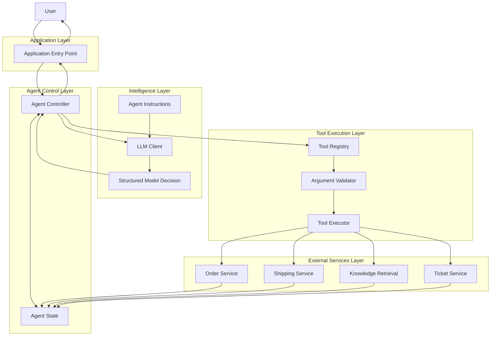
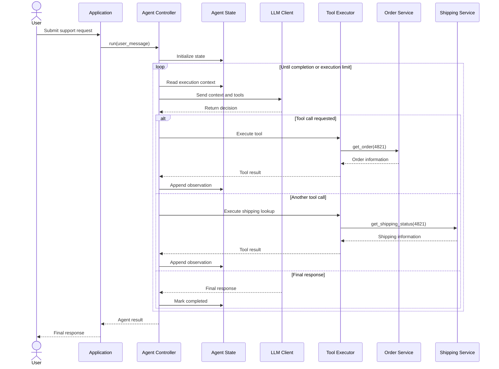
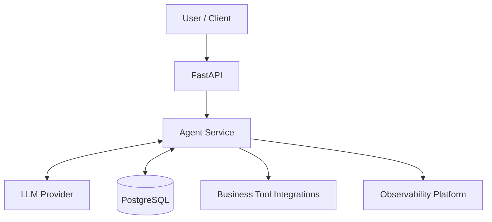

# Agentic AI Engineering — System Architecture

## 1. Overview

### Purpose

This document describes the software architecture of the Agentic AI Engineering project.

The project aims to build a customer support AI agent capable of understanding customer requests, retrieving business information, invoking external tools, observing execution results, and generating responses.

The implementation starts with plain Python and progressively introduces production-oriented agent engineering capabilities.

### Architectural Goals

- Build a modular and extensible AI agent.
- Separate LLM reasoning from application execution.
- Support structured tool calling.
- Maintain execution state.
- Support multi-step reasoning and tool execution.
- Enforce execution limits and validation.
- Enable future integration with RAG and external APIs.
- Establish a foundation for production-ready agent systems.

### Initial Use Case

Customer support investigation.

Example request:

"My order #4821 has not arrived. Please investigate and tell me what happened."

The agent should:

1. Understand the customer request.
2. Identify the order ID.
3. Retrieve order information.
4. Retrieve shipping information.
5. Analyze the results.
6. Generate a factual response.

Ticket creation and other sensitive write operations will require human approval.

---

## 2. Architecture Principles

| Principle | Description |
|---|---|
| Separation of Concerns | Each component has a defined responsibility |
| Modularity | Components can evolve independently |
| Explicit Tool Execution | Only registered tools can execute |
| Structured Communication | Use schemas for model-generated actions |
| State Management | Maintain execution context |
| Controlled Autonomy | Limit iterations and available actions |
| Security by Design | Validate inputs and enforce permissions |
| Observability | Record decisions, tool calls, and failures |
| Extensibility | Support additional tools and model providers |

---

## 3. High-Level Architecture

The system consists of five logical layers.

1. Application Layer
2. Agent Control Layer
3. Intelligence Layer
4. Tool Execution Layer
5. External Services Layer

### Architecture Diagram



### Layer Responsibilities

| Layer | Responsibility |
|---|---|
| Application | Receives requests and returns responses |
| Agent Control | Manages the execution lifecycle |
| Intelligence | Determines the next action |
| Tool Execution | Validates and executes tool calls |
| External Services | Provides business operations and data |

---

## 4. Component Architecture

### 4.1 Application Entry Point

**Component:** `main.py`

Responsibilities:

- Load environment configuration.
- Initialize the agent.
- Receive the user request.
- Execute the agent.
- Return the final response.

The entry point should not contain agent reasoning or business logic.

### 4.2 Agent Controller

**Component:** `agent.py`

The Agent Controller is the central orchestration component.

Responsibilities:

- Initialize agent execution.
- Manage the execution loop.
- Send context to the LLM.
- Process model decisions.
- Identify requested tool calls.
- Delegate tool execution.
- Return observations to the LLM.
- Determine when execution should stop.
- Produce the final response.

The Agent Controller owns the execution lifecycle.

### 4.3 Agent State

**Component:** `state.py`

Maintains the context of the current execution.

Initial state structure:

| Attribute | Type | Purpose |
|---|---|---|
| user_message | string | Original user request |
| input_items | list | Model conversation and tool results |
| iteration | integer | Current model iteration |
| status | string | Execution status |
| observations | list | Recorded tool observations |
| final_response | string or null | Final agent response |

Initial implementation uses in-memory state.

Future versions will introduce persistent state and checkpointing.

### 4.4 LLM Client

**Component:** `llm_client.py`

Responsible for model communication.

Responsibilities:

- Connect to the model provider.
- Submit instructions and conversation context.
- Provide available tool definitions.
- Receive model responses.
- Return structured function calls.

The LLM Client must not execute business functions.

### 4.5 Tool Registry

**Component:** `tools/registry.py`

Maintains the collection of tools available to the agent.

Each tool definition contains:

- Tool name.
- Description.
- Input parameters.
- JSON Schema.
- Validation requirements.

The registry acts as an allowlist of available capabilities.

### 4.6 Tool Executor

**Component:** `tools/executor.py`

Responsible for executing registered tools.

Execution responsibilities:

1. Receive a tool name.
2. Verify that the tool is registered.
3. Validate arguments.
4. Invoke the corresponding function.
5. Capture execution results.
6. Return structured observations.

Unknown tools must be rejected.

### 4.7 Support Tools

**Component:** `tools/support_tools.py`

Contains customer support business operations.

Initial tools:

| Tool | Responsibility |
|---|---|
| get_order | Retrieve order information |
| get_shipping_status | Retrieve shipping information |
| search_knowledge | Search support documentation |
| create_ticket | Create an escalation ticket |

Initial implementation uses mock data.

Future implementations will integrate with external services.

---

## 5. Agent Execution Architecture

### Execution Model

The agent uses an iterative execution model.

**Reason → Act → Observe → Decide**

The model decides the next action, while the Agent Controller manages execution.

### Execution Sequence



### Execution Algorithm

```text
START
  |
  v
Initialize Agent State
  |
  v
Send Context to LLM
  |
  v
Receive Model Response
  |
  v
Does Response Contain Tool Calls?
  |
  +---- YES
  |       |
  |       v
  |   Validate Tool
  |       |
  |       v
  |   Execute Tool
  |       |
  |       v
  |   Capture Observation
  |       |
  |       v
  |   Update Agent State
  |       |
  |       +------> Repeat
  |
  +---- NO
          |
          v
      Extract Final Response
          |
          v
       Mark Complete
          |
          v
         END
```

### Termination Conditions

Execution must stop when:

- The LLM returns a final response.
- The maximum iteration limit is reached.
- A non-recoverable error occurs.
- The request is cancelled.
- A security policy prevents further execution.

The initial implementation enforces a maximum model iteration count.

Production implementation must also enforce a separate tool-call budget and execution timeout.

---

## 6. Tool Calling Architecture

### Tool Calling Flow

The LLM does not execute tools directly.

It returns a structured function call that the application processes.

Example:

```json
{
  "name": "get_order",
  "arguments": {
    "order_id": 4821
  }
}
```

Execution flow:

```text
LLM
 |
 v
Function Call
 |
 v
Agent Controller
 |
 v
Tool Registry
 |
 v
Tool Executor
 |
 v
Argument Validation
 |
 v
Business Function
 |
 v
Tool Result
 |
 v
Agent Controller
 |
 v
LLM
```

### Tool Execution Rules

- Only registered tools are executable.
- Tool arguments must be validated.
- Unknown tools must be rejected.
- Tool execution errors must be captured.
- Tool results must use structured representations.
- Sensitive operations must enforce authorization.
- Write operations must support approval and idempotency where applicable.

---

## 7. Data Flow

### Input

The application receives:

```json
{
  "message": "My order #4821 has not arrived."
}
```

### Agent Context

The Agent Controller initializes:

```text
AgentState
    |
    +-- user_message
    +-- input_items
    +-- iteration
    +-- observations
    +-- status
    +-- final_response
```

### Tool Execution

Order lookup:

```json
{
  "order_id": 4821,
  "customer_id": 101,
  "status": "shipped"
}
```

Shipping lookup:

```json
{
  "order_id": 4821,
  "status": "delayed",
  "estimated_delivery": "2026-11-16"
}
```

### Final Response

```text
Your order #4821 has been shipped but is currently
delayed.

The estimated delivery date is November 16, 2026.
```

These are illustrative mock-data results.

---

## 8. Technology Stack

| Category | Technology | Purpose |
|---|---|---|
| Language | Python | Core implementation |
| Package Manager | uv | Dependency management |
| LLM Provider | OpenAI | Model inference |
| LLM Interface | Responses API | Model communication |
| Validation | Pydantic | Structured validation |
| Configuration | python-dotenv | Environment configuration |
| Testing | pytest | Automated tests |
| Code Quality | Ruff | Linting and formatting |
| Version Control | Git | Source management |

### Future Technology Integrations

| Category | Technology | Planned Purpose |
|---|---|---|
| Agent Framework | LangGraph | Stateful agent workflows |
| Database | PostgreSQL | Persistent state |
| Vector Search | pgvector | Knowledge retrieval |
| API | FastAPI | Agent service interface |
| Observability | OpenTelemetry | Tracing and metrics |
| LLM Tracing | Langfuse | Agent execution monitoring |
| Deployment | Docker | Containerization |

These technologies are planned extensions, not dependencies of the initial implementation.

---

## 9. Security Architecture

Security must be enforced by the application, not delegated entirely to the LLM.

Initial controls:

- Store API credentials in environment variables.
- Never expose secrets in prompts or logs.
- Restrict tool execution to registered functions.
- Validate tool arguments using Pydantic.
- Reject unknown tools.
- Keep read operations separate from write operations.

Planned controls:

- User authentication.
- Role-Based Access Control (RBAC).
- Tool-level authorization.
- Human approval for sensitive operations.
- Prompt injection defenses.
- Output validation.
- Rate limiting.
- Tool execution timeouts.
- Audit logging.
- Idempotency for write operations.

---

## 10. Error Handling and Reliability

Potential failure scenarios:

| Failure | Expected handling |
|---|---|
| LLM API unavailable | Controlled failure and retry policy |
| Invalid tool arguments | Reject execution |
| Unknown tool | Reject execution |
| Business service unavailable | Capture error |
| Tool timeout | Stop or apply bounded retry |
| Model does not finish | Enforce execution limit |
| Malformed model response | Reject or handle safely |
| Unauthorized operation | Deny execution |

Production reliability requirements:

- Bounded retries.
- Exponential backoff where appropriate.
- Request timeouts.
- Cancellation support.
- Tool-call budgets.
- Idempotency.
- Structured error responses.
- Persistent execution state.
- Recovery and checkpointing.

---

## 11. Observability Architecture

The system should eventually capture:

| Signal | Example |
|---|---|
| Execution ID | Unique agent execution |
| Model | Model identifier |
| Iteration | Number of reasoning cycles |
| Tool Name | get_order |
| Tool Duration | Execution time |
| LLM Latency | Model response duration |
| Token Usage | Input and output tokens |
| Error | Tool or model failure |
| Final Status | Completed or failed |

Sensitive customer information and secrets must be redacted from logs.

---

## 12. Deployment Architecture

The initial project runs locally as a Python application.

Target deployment architecture:



Future deployment will introduce:

- Docker containers.
- API authentication.
- Database persistence.
- Centralized logging.
- Metrics and distributed tracing.
- Rate limiting.
- Secrets management.
- CI/CD pipelines.

---

## 13. Architectural Decisions

| Decision | Rationale |
|---|---|
| Plain Python first | Understand agent fundamentals before using frameworks |
| Agent Controller | Centralize execution lifecycle |
| Separate LLM Client | Isolate model-provider integration |
| Tool Registry | Restrict available capabilities |
| Tool Executor | Separate decision-making from execution |
| Pydantic validation | Validate structured tool arguments |
| In-memory state initially | Reduce initial implementation complexity |
| Sequential tool execution | Simplify the first execution model |
| Mock business data | Develop without external system dependencies |
| Human approval for writes | Prevent uncontrolled business actions |

---

## 14. Current Architecture Limitations

The current implementation is a learning baseline, not a production-ready system.

| Area | Current State | Future Improvement |
|---|---|---|
| Agent Execution | Basic execution loop | Robust lifecycle management |
| Tool Registry | Static definitions | Reusable registration |
| Tool Validation | Pydantic | Tool-specific business validation |
| State | In-memory | Persistent checkpointing |
| Memory | Basic context | Short-term and long-term memory |
| Error Handling | Basic exception capture | Retry and recovery policies |
| Security | Tool allowlist | RBAC and authorization |
| Human Approval | Not implemented | Approval workflow |
| Observability | Console output | Structured traces and metrics |
| Deployment | Local execution | Production service |

---

## 15. Future Architecture Evolution

The architecture will evolve incrementally.

### Stage 1 — Core Agent

- Plain Python implementation.
- LLM integration.
- Structured tool calling.
- Agent execution loop.
- Basic state management.

### Stage 2 — Advanced Tool Engineering

- Dynamic tool registration.
- Tool contracts.
- Tool permissions.
- Error handling.
- Retries and idempotency.

### Stage 3 — Agent Memory and State

- Persistent execution state.
- Conversation history.
- Long-term memory.
- Checkpointing.

### Stage 4 — Agent Workflows

- Conditional routing.
- Multi-step planning.
- Workflow orchestration.
- Human-in-the-loop.

### Stage 5 — Multi-Agent Architecture

- Specialized agents.
- Supervisor pattern.
- Agent communication.
- Delegation and coordination.

### Stage 6 — Production Agent Engineering

- Evaluation.
- Guardrails.
- Security.
- Observability.
- Scalability.
- Deployment.

---

## 16. Summary

The architecture establishes a modular foundation for building agentic AI applications.

The most important architectural separation is:

- The LLM decides what action should happen.
- The Agent Controller manages the execution lifecycle.
- The Tool Registry defines available capabilities.
- The Tool Executor validates and executes actions.
- The Agent State maintains execution context.

This separation makes it possible to evolve the project from a basic LLM-powered agent into a reliable, secure, observable, and production-oriented agentic system.

**Current implementation:** Core Agent — Day 1 and Day 2.

**Next architectural milestone
